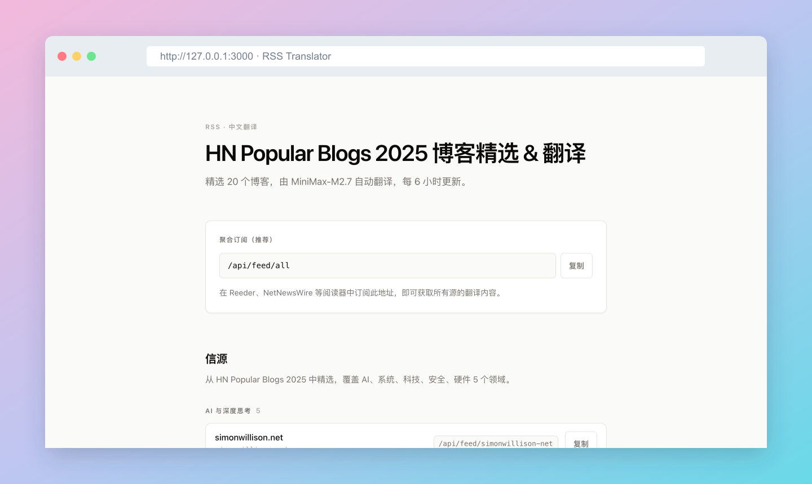

# 📰 RSS Translator

HN Popular Blogs 2025 博客精选 & 翻译。

👉 [访问网站](https://rss.kaho.io) · [订阅全部博客](https://rss.kaho.io/api/feed/all)

* 从 HN Popular Blogs 2025 中精选 20 个博客，涵盖 AI、系统、科技、安全和硬件
* 自动抓取文章正文，将标题和全文译成中文，保留排版、链接与代码
* 每 6 小时检查更新，长文分段翻译，完成后发布到 RSS
* 支持聚合订阅和单独订阅，可在 Reeder、NetNewsWire 等阅读器中阅读
* 基于 Next.js，使用 MiniMax 翻译，部署在 Vercel，代码托管于 GitHub

希望让阅读英文技术博客这件事，变得轻松一点 ❤️

---

Curated blogs from HN Popular Blogs 2025, translated into Chinese.

👉 [Visit the website](https://rss.kaho.io) · [Subscribe to all blogs](https://rss.kaho.io/api/feed/all)

* 20 selected blogs covering AI, systems, technology, security, and hardware
* Article titles and full text translated into Chinese, with formatting, links, and code preserved
* New articles checked every six hours; long translations published once complete
* Combined and individual RSS feeds for readers such as Reeder and NetNewsWire
* Built with Next.js, translated with MiniMax, deployed on Vercel, and hosted on GitHub

Making English tech blogs a little easier to read ❤️

---

本地开发：使用 Node.js 24，运行 `npm ci`，将 `.env.example` 复制为 `.env.local` 并配置后执行 `npm run dev`。

开发约定见 [AGENTS.md](AGENTS.md)，部署、环境变量与故障排查见 [运行与维护](docs/operations.md)。

